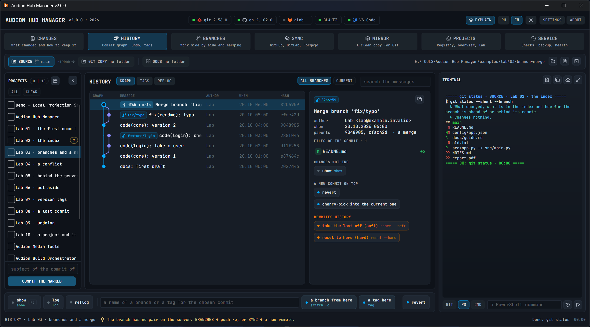

# Audion Hub Manager

<!-- audion:release -->
<p align="center">
  <a href="https://audion.dev/downloads/hub-manager"></a>
  <a href="https://github.com/Tensionix/hub-manager/releases/latest"></a>
  <a href="https://github.com/Tensionix/hub-manager/releases"></a>
  <a href="https://github.com/Tensionix/hub-manager/blob/main/LICENSE"></a>
</p>

**Version 2.0.0** · 2026-10-25 · 112.0 MB

- [Direct download](https://audion.dev/get/hub-manager/2.0.0/Audion_Hub_Manager_v2.0.0_Full.zip) — unmetered, no rate limits
- [Project page](https://audion.dev/downloads/hub-manager) — every version and how to install

<p align="center"></p>

`SHA-256: a503576c0f67a447600d9d0dffb81623bc1a7bb60da30b668d2d638868316fa1`

---

An **Audion** tool, published by [Tensionix](https://github.com/Tensionix).
<!-- /audion:release -->


[English README](docs/README_EN.md) · [User Guide](docs/USER_GUIDE_EN.md) | [Русский README](docs/README_RU.md) · [Руководство](docs/USER_GUIDE_RU.md)

[Git wiki](docs/GIT_WIKI_HUB_MANAGER_EN.md) · [Console command](docs/CLI_EN.md) · [How it is built](docs/TECH_SPEC_EN.md) · [Decisions](docs/DECISIONS_EN.md) · [History](docs/CHANGELOG_EN.md)

**Contents**

- [Why](#why)
- [How it looks](#how-it-looks)
- [What it does](#what-it-does)
- [Start](#start)
- [What lies where](#what-lies-where)
- [A project record](#a-project-record)
- [Back from the mirror](#back-from-the-mirror)
- [Rules not to break](#rules-not-to-break)
- [Checks](#checks)

A portable Windows program to keep projects in Git and to learn Git on real work. The window runs real `git`, shows
every command whole and says in plain words what it did and how to undo it. A project lives in three layers meanwhile:
the live source, a clean GIT COPY for the history and the server, a folder of documents to read.

> The source stays whole. The mirror stays clear. The documents stay readable. Git stops being frightening.

## Why

A live project has two properties that do not go together. It has to be complete — with its builds, caches, logs and
the settings of this machine, or it cannot be worked on. And it has to be clear — so its history can be read, its changes
compared and a copy brought back without sorting out what is source and what is a trace of yesterday's build.

So a project lives in three layers:

```
SOURCE      the whole project, the only source of truth
GIT COPY    a clean mirror by a profile: code, documents, configs without secrets; its own .git
DOCS        a layer to read: Markdown and texts for Obsidian, LogSeq or a plain folder
```

The GIT COPY can be deleted and built again. DOCS is synced by anything. The mirror never changes the SOURCE.

The other half of the idea is Git without learning by heart. All the Git commands of the program are one table (the
canon, 63 operations): the command, its risk, what it does and how to undo it, in two languages. A button of the window
is an entry of that table, and its caption is the command as typed in a terminal. One works and learns at the same
time.

## How it looks

The window speaks Russian and English (RU / EN at the top right); this guide names its labels as the English window
shows them, with the Russian label in brackets.

At the top: the project from the registry and the layer switch — SOURCE (ИСХОДНИК), GIT COPY (GIT-КОПИЯ) or DOCS. Git
commands go into the repository of the chosen layer. Under it, seven sections:

| Section | What is there |
|---|---|
| CHANGES (ИЗМЕНЕНИЯ) | files by stage (conflicts, in the index, changed, new), the diff of the chosen file, the commit: type, scope, version, tag |
| HISTORY (ИСТОРИЯ) | the graph of the commits of every branch, a commit with its files, the history of a file, tags, reflog; revert, cherry-pick, reset |
| BRANCHES (ВЕТКИ) | your branches and the server's, compare, merge, edits put aside (stash), the way out of a stuck merge |
| SYNC (СИНХРОНИЗАЦИЯ) | the remotes of the repository, fetch, pull, push, an address for GitHub, GitLab, Codeberg, Forgejo, Gitea, the check of access, a Forgejo token |
| MIRROR (ЗЕРКАЛО) | the plan SOURCE → GIT COPY by the profile, apply, the BLAKE3 check |
| PROJECTS (ПРОЕКТЫ) | the panel of the folders of the machine, the registry with the state of each layer, batch checks, finding projects in a folder, a clone, the Git lab |
| SERVICE (ОБСЛУЖИВАНИЕ) | the scan for secrets and heavy files, a bundle backup, the health of the repository, Git's settings, the tools of the machine |

Under the page of a section, a bar of its frequent operations with their fields: the subject of a commit, a branch name,
an address. At the bottom, the terminal: every command whole, its output in Git's colours, the explanation and the
outcome with its exit code; the command line takes `git`, the program's PowerShell or `cmd`. A hint line names the next
step: "3 in the index: write the subject below and press COMMIT".

## What it does

- **All of Git for every day** — state, diff, index, a commit of some files, version tags, branches, merge, edits put
  aside, history and graph, undo and the rescue of the lost, remotes, fetch, pull, push, a backup without a server. The
  rare and dangerous are templates one finishes and runs on purpose.
- **Danger asks.** Restore a file, reset a branch, rewrite the last commit — the window shows the whole command, what is
  not committed now and how to undo it; `reset --hard` is confirmed by typing the word RESET.
- **A commit by the profile.** A file outside the profile of the project gets into neither the index nor a commit: builds,
  logs and secrets do not go into the history.
- **The mirror** — plan, apply and check of SOURCE against GIT COPY by BLAKE3 sums; a project brought back from the mirror.
- **The project registry** — the real roots found in a shared folder, records without folders and duplicates cleaned, the
  state of every project at once.
- **Access without stored passwords** — SSH keys, Git Credential Manager, `gh` and `glab`; a personal Forgejo or Gitea
  token is checked on the server and goes to Git's credential store, not to the program's files.
- **The Git lab** — ten repositories in known states: a conflict, being behind a server, a lost commit and more. Built anew
  with one button, with the same hashes on any machine.
- **The console command** `hub_cli.cmd` — everything the window does beyond Git, without the window: one JSON per command.

## Start

```cmd
Start.exe
```

Needs Windows 10 or 11 (x64) and Git installed (`git` on `PATH`); `gh`, `glab` and VS Code are optional. The window, the
program's PowerShell and the engine's Python lie in the program folder. If `runtime\` is empty, the builder makes the
Python environment: `builder_main.cmd` → [01].

To begin with the lab: PROJECTS → GIT LAB (УЧЕБНАЯ ЛАБОРАТОРИЯ) → "build anew" (создать заново), then choose `lab_01` in
the list of projects.

## What lies where

| Path | What |
|---|---|
| `Start.exe` | starts the window |
| `App\` | the window `AudionHubManager.exe` and the program's PowerShell 7 `AudionPs.exe` |
| `hub_cli.cmd`, `system_core\` | the console command and the Python engine: registry, mirror, checks, Forgejo, the lab, the Git canon |
| `config\` | the registry, the mirror profiles, known remotes and Forgejo servers (no tokens), the storage layout, the window's settings |
| `examples\` | a demo project and the Git lab `examples\lab` |
| `logs\` | the reports of the mirror, the checks and the scans: `logs\<project>\` |
| `builder_main.cmd`, `install\` | the builder: the Python environment, the checks, the build of the window |
| `runtime\`, `wheelhouse\` | the program's Python and its packages |
| `docs\` | these documents |

## A project record

A record of the registry — `hub_projects.json` in the root of the projects, each root with its own:

```json
{
  "id": "audion_hub_manager",
  "title": "Audion Hub Manager",
  "source_path": "Audion Hub Manager",
  "projection_path": "S:/Audion/Hub Data/Audion Hub Manager",
  "docs_path": "S:/Audion/Docs/Projects/Audion Hub Manager",
  "profile": "audion_python_project_projection",
  "default_branch": "main"
}
```

| Field | What |
|---|---|
| `source_path` | SOURCE; a relative path counts from the root of the projects |
| `projection_path` | GIT COPY, its own `.git`, rebuilt by the mirror |
| `docs_path` | DOCS, optional |
| `profile` | what goes into the GIT COPY and into a commit: a profile of `config\projection_profiles.json` |
| `default_branch` | the branch pull and push take while a branch has no pair on the server; `git init` starts the history with it |

Paths inside the root of the projects are written from it (`Hub Data/Project`): the root moves with its registry to
another folder or disk. A GIT COPY may lie elsewhere or on another disk too — its path is then written in full. The
default root is the folder beside the program; another is chosen by the folder button of the column of projects, and
its menu also imports a registry from a file and exports it into one.

A search makes a record: PROJECTS → a folder in the panel FOLDERS → "find in a folder" (найти в папке) or `hub_cli.cmd projects scan FOLDER --import`. A
folder that is a project itself (it has `.git`, `README.md`, `pyproject.toml` or the like) finds itself; a shared folder
without such marks finds the projects in its subfolders. A cloned project is entered by the button "to the registry" (в
реестр). The folders and the branch of a record are edited in PROJECTS → RECORD (ЗАПИСЬ) or by `hub_cli.cmd projects set`.

## Back from the mirror

The SOURCE is lost, the GIT COPY is alive:

```cmd
robocopy "<GIT COPY>\<Project>" "<root>\<Project>" /E /COPY:DAT /DCOPY:DAT /R:1 /W:1 /XJ
```

What passed the profile comes back; runtimes and builds are built again.

## Rules not to break

1. SOURCE is the source of truth; the mirror never changes it.
2. GIT COPY is derived: it can be deleted and built again.
3. `.git/**` is protected from the mirror's scan, deletion and upkeep.
4. A real write of the mirror needs an explicit intent.
5. Only what the profile lets through goes into the index and a commit.
6. Tokens, passwords, private keys and the paths of this machine stay out of shared settings.
7. What belongs to the machine lives in `*.local.json`, `.env` and other excluded files.
8. Check reports are written only into `logs\<project>\`.
9. The DOCS layer is not checked on its own: its technical copy is in the GIT COPY already.

## Checks

```cmd
runtime\python.exe -m pytest -q tests
install\Build-App.cmd
install\verify_portable_env.cmd
```

The tests run the engine, the console command and every command of the canon on a fresh copy of the lab. A build of the
window ends with its self-check; `verify_portable_env.cmd` checks the environment, the console command, `Start.exe` and the
built window.
